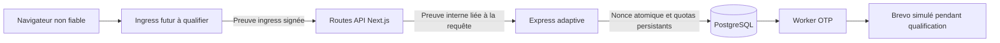

# LOT 5 — Frontières de confiance et identité réseau

Évolution Vercel : [VERCEL_NETWORK_STEP2.md](VERCEL_NETWORK_STEP2.md) décrit l'adaptateur optionnel maintenant préparé et ses conditions de confiance. Le présent document conserve la qualification initiale du mode edge ; ses mentions d'un adaptateur d'hébergement absent correspondent à cette version initiale. Le protocole HMAC et les contrôles PostgreSQL restent inchangés.

Travail local du 31 octobre 2026, sans déploiement ni modification de secrets.
La qualification utilise uniquement un cluster PostgreSQL natif temporaire,
des identités fictives et un transport Brevo simulé.

## 1. Architecture constatée avant modification

Sources examinées : `docs/DEPLOYMENT.md`, `frontend/src/lib/adaptive-proxy.ts`,
les routes `frontend/src/app/api`, `backend/src/app.ts`, les routes adaptatives
et les services de budget/livraison. Aucun fichier `.env` n'est inspecté.

Le navigateur appelle les routes API Next.js. `adaptiveProxy` relaie les routes
Soft Skills vers Express via `API_INTERNAL_URL` ; le jeton du cookie httpOnly
devient un Bearer serveur-à-serveur. Les autres proxys Next.js servent les anciens
parcours par code et les fonctions administrateur. Le middleware Next.js conserve
ses protections d'origine, de type et de taille de corps.

L'émission OTP Express utilisait exclusivement `req.socket.remoteAddress` : elle
identifiait donc le BFF et pouvait regrouper tous ses étudiants. Le limiteur HTTP
de démarrage utilisait lui aussi une petite enveloppe commune au proxy. Les
compteurs PostgreSQL étaient déjà persistants par e-mail, NETWORK et GLOBAL.
`TRUST_PROXY` permettait une configuration Express, sans établir la provenance
réelle d'une IP devant Next.js. Next.js App Router ne fournit pas de socket TCP
client authentifié utilisable dans ce code.

L'utilisateur a confirmé que l'hébergement est **encore indéfini**. Le dépôt ne
prouve ni un ingress Vercel, ni Nginx, ni Caddy, ni une chaîne de proxies connue.
Il n'existe donc aucune base pour accepter aujourd'hui XFF, X-Real-IP, Forwarded
ou un en-tête propriétaire comme identité fiable. Aucune configuration spécifique
à un fournisseur n'est activée par ce lot.

## 2. Architecture après modification

Le protocole applicatif est prêt pour une future passerelle, mais **l'adaptateur
d'hébergement n'est pas implémenté ou activé**, faute d'architecture réelle à
vérifier. Sans attestation réseau vérifiable, une opération OTP retourne
`503 / EMAIL_NETWORK_UNAVAILABLE` avant challenge, tentative, budget ou envoi.
Les consultations d'un parcours existant restent possibles avec leur jeton et
une preuve interne valide, même si l'identité réseau est indisponible.

### Frontière ingress → Next.js

Une passerelle autorisée possède `SKILLQUEST_EDGE_HMAC_KEY`. Elle doit déterminer
l'IP à partir de son socket client réel ou d'une chaîne d'infrastructure vérifiée,
puis produire `x-skillquest-edge-proof`. Elle doit écraser les preuves reçues du
navigateur. Elle ne doit jamais signer simplement son XFF entrant.

Le protocole partagé fournit `signProof` pour un futur adaptateur : audience
`skillquest-bff`, méthode, chemin ET query exacts du navigateur, SHA-256 du corps
brut et du header Authorization, IP validée, UUID aléatoire et horodatage.
L'attestation est signée HMAC-SHA-256. Next.js vérifie la signature, l'audience,
les champs et la fraîcheur avant de normaliser le réseau. XFF/X-Real-IP ne sont
jamais consultés. Les en-têtes internes entrants ne sont pas relayés librement.

Sur un serveur, le futur adaptateur devra vérifier le pair et toute éventuelle
allowlist CIDR/mTLS du proxy amont avant d'interpréter une chaîne IP. Sur une
plateforme gérée, il faudra établir sa garantie d'écrasement/authentification et
son impossibilité de contournement. Ces règles dépendant de l'hébergement restent
à définir ; aucune allowlist inventée ou confiance générale n'est livrée.

### Frontière Next.js → Express

Clé distincte `SKILLQUEST_PROXY_HMAC_KEY`, partagée uniquement par Next.js et
Express. La preuve `x-skillquest-proxy-proof` utilise l'audience `skillquest-api`
et lie méthode, chemin/query backend, corps réellement relayé, Bearer réellement
relayé, réseau normalisé, nonce et horodatage. Les redirections de l'upstream sont
refusées pour éviter le transfert de preuves/jetons vers une autre destination.

Le protocole est `v1.<JSON-base64url>.<HMAC-hex>`, avec parsing et champs stricts,
comparaison de signature en temps constant, validité de 60 secondes et tolérance
future de 5 secondes. Les clés doivent être deux secrets indépendants de 32 octets
encodés en base64 canonique, distincts des clés OTP et du pepper historique. Leur
contenu n'est jamais journalisé ou fourni au navigateur.

Express impose `trust proxy=false`. La preuve est obligatoire pour tout le
namespace `/api/v1/adaptive` en production. Une signature invalide est refusée
avant accès à PostgreSQL. La fraîcheur et l'insertion unique du nonce sont décidées
dans une seule instruction SQL, avec une référence temporelle PostgreSQL unique
et `ON CONFLICT DO NOTHING`.
Une seule requête peut consommer ce nonce, entre connexions et instances.

Next.js conserve le nonce ET l'horodatage de l'attestation ingress. Il ne peut
pas prolonger sa durée de vie en réemballant un ancien token. Rejouer cette
attestation via plusieurs instances Next.js aboutit au même nonce persistant.
Le corps et le Bearer empêchent de réutiliser une preuve pour une autre opération
ou un autre utilisateur. Une erreur SQL renvoie une erreur technique, sans
désactiver le contrôle.

Les nonces expirent après 65 secondes à compter de leur consommation et sont
purgés chaque minute, par lots de 1000. Leur disparition ne rend pas une preuve
expirée valide. Un retry légitime doit recevoir une nouvelle attestation ingress ;
les opérations OTP restent idempotentes par le mécanisme existant de gate/job.

### Accès direct et périmètre

Un accès direct aux API adaptatives sans preuve retourne 403. Une clé absente
ou incorrectement configurée rend le service indisponible, pas permissif. Le
démarrage serveur vérifie la configuration requise. `NODE_ENV=production` ne peut
pas désactiver le contrôle via un paramètre `off` ou `local`.

Les anciens endpoints par code de session et les routes administrateur conservent
leurs contrôles existants. Ils ne permettent pas de créer une participation
adaptative sans OTP. Les mots de passe, rôles, sessions admin et cookies ne sont
pas modifiés. La santé reste publique. La preuve interne n'est pas un remplacement
de l'authentification participant/admin ni d'une ACL réseau devant Express.

Le mode de développement nécessite `SKILLQUEST_PROXY_MODE=local` explicite pour
accepter l'API locale sans clé. Il est limité aux pairs loopback. Les anciens tests
utilisent le mode test local ; les nouveaux tests du LOT 5 forcent `required` et
exercent aussi le refus en production. Les 48 tests historiques ne constituent
donc pas, à eux seuls, une preuve du mode production : les scénarios LOT 5 la
complètent explicitement.

## 3. Quotas, NAT, IPv6 et minimisation

- IPv4 : représentation /32 ; IPv4-mapped IPv6 est ramenée à la même identité.
- IPv6 : /64 canonique, pour éviter de contourner les contrôles en changeant
  seulement les bits de confidentialité. Les listes, ports, zones et chaînes
  ambiguës sont rejetés.
- NETWORK vérifié : HMAC du **couple réseau–e-mail normalisé**, dans un espace
  `proof-v1` distinct. Un quota de fautes épuisé par un e-mail sur un NAT ne bloque
  pas un autre e-mail de la même classe. Il n'existe plus de petit plafond OTP
  commun à tous les clients du BFF.
- Les plafonds IDENTITY et GLOBAL, le budget Brevo, les compteurs PostgreSQL,
  le verrou partagé, le circuit fournisseur et la réconciliation restent actifs.
  Changer de réseau mobile ne réinitialise pas les fautes par e-mail. Les alias
  Gmail suivent la normalisation existante. Le limiteur HTTP d'appoint du start
  utilise l'identité e-mail pseudonymisée plutôt que le socket BFF partagé.
- `OTP_NETWORK_DAILY_SENDS` et `OTP_NETWORK_DAILY_FAILURES` limitent donc ce couple
  en mode vérifié, **pas un réseau entier**. Un hard cap commun au NAT recréerait
  précisément le blocage collectif à éviter. Cette nouvelle portée est explicite.

Les anciennes tâches déjà chiffrées gardent leur origine historique jusqu'à leur
drainage/expiration ; aucune réécriture des ciphertexts ni remise à zéro des
quotas par identité ou globaux n'est effectuée. Les anciens compteurs NETWORK
restent soumis à leur purge habituelle.

L'IP complète reste seulement dans l'attestation ingress éphémère. Le backend
reçoit un préfixe minimisé ; les compteurs n'en stockent que le HMAC combiné.
Le payload de livraison garde le préfixe chiffré pendant sa courte durée utile.
Les nonces stockent seulement UUID et échéance. La rétention LOT 1 reste en place :
fenêtre de quota UTC puis marge de 48 heures, payload expiré sans bail, conservation
des réservations/états incertains nécessaires. Configurer la suppression des
headers sensibles dans les logs de l'hébergement et les traces HTTP.

## 4. Configuration à préparer après choix de l'hébergement

- `NODE_ENV=production` pour les deux services.
- `API_INTERNAL_URL` : origine Express maîtrisée, HTTPS ou transport privé protégé.
  Le paquet backend doit également inclure le dossier `shared/` à la racine du workspace.
- `PUBLIC_APP_ORIGIN` : origine HTTPS exacte pour la protection navigateur existante.
- `SKILLQUEST_PROXY_HMAC_KEY` : clé interne dédiée dans Next.js et Express, jamais
  `NEXT_PUBLIC_*`, jamais la clé ingress ni un secret OTP.
- `SKILLQUEST_EDGE_HMAC_KEY` : clé ingress dédiée dans la passerelle et Next.js,
  avec un adaptateur sélectionné et vérifié avant toute attestation.
- `SKILLQUEST_PROXY_MODE=required` : utile pour la qualification ; en production
  l'obligation est imposée indépendamment du paramètre.
- `TRUST_PROXY` : aucune activation Express ; toute confiance CIDR/mTLS/plateforme
  doit être établie dans l'adaptateur d'ingress réellement choisi.
- Les plafonds `OTP_*` et `EMAIL_*` existants restent à dimensionner à partir du
  budget réel et de la taille des classes, sans dépasser la limite fournisseur.

La migration **additive** `20261031010000_proxy_request_nonce` doit être appliquée
avant activation dans une future opération autorisée. Les 15 fichiers historiques
ne sont pas modifiés. Aucune commande de migration, configuration ou démarrage de
production n'a été exécutée pendant ce lot. Les clocks doivent être synchronisées.

## 5. Qualification, preuves et limites

Lanceur local : `output/lot4-lot5-proxy-20261031/run-native.cjs`. Il vérifie l'identité
et le schéma vide d'un cluster natif propriétaire, utilise seulement le loopback
et des données synthétiques, applique les migrations à ce seul cluster, puis
arrête son serveur et supprime ses données après contrôle du port.

Les tests couvrent les falsifications XFF/X-Real-IP, accès direct, preuves invalides,
altérées, périmées, futures, liées au mauvais corps/route/Bearer, rejeux directs et
via Next.js, consommation concurrente des nonces, indisponibilité réseau, NAT,
IPv4/mapped/IPv6, quotas e-mail malgré mobilité, dernière unité Brevo atomique,
erreur SQL bloquante, purge des nonces et parcours OTP FR/AR. Les 48 tests natifs
historiques conservent leurs assertions, dont reprise à 30 jours, rapports,
sessions administrateur, purge et rotation OTP. Les parcours Next.js sont exercés
via leurs handlers avec une passerelle simulée ; ce n'est pas un essai sur une
infrastructure d'hébergement ou un navigateur déployé.

Les résultats exacts, sauvegardes SHA-256, liste des fichiers et journaux sont
référencés dans `output/lot5-proxy-20261031/qualification.json` et `integrity.json`.

Fichiers applicatifs existants modifiés :

- `backend/src/app.ts`
- `backend/src/server.ts`
- `backend/src/routes/adaptive.routes.ts`
- `backend/src/services/email-budget.service.ts`
- `backend/prisma/schema.prisma`
- `frontend/src/lib/adaptive-proxy.ts`
- `frontend/src/lib/api-body.ts`
- `docs/DEPLOYMENT.md`

Fichiers créés, hors sauvegardes et journaux de qualification :

- `shared/network-proof.mjs`
- `shared/network-proof.d.mts`
- `backend/src/security/proxy-network.ts`
- `backend/src/services/proxy-nonce-retention.service.ts`
- `backend/prisma/migrations/20261031010000_proxy_request_nonce/migration.sql`
- `frontend/src/lib/network-proof.ts`
- `backend/tests/network-proof.test.ts`
- `backend/tests/proxy-network-native.test.ts`
- `frontend/tests/network-proof.test.ts`
- `docs/LOT5_PROXY_TRUST.md`

Limites résiduelles :

1. **Activation réelle bloquée par le choix d'hébergement** et la vérification du
   futur ingress. Sans attestation, l'OTP est volontairement indisponible.
2. IP, NAT, /64 et réseau mobile ne prouvent pas une personne. Un attaquant disposant
   de plusieurs identités e-mail peut encore consommer une part du budget global.
   Aucune garantie contre ce type de Sybil n'est possible sans un contrôle d'accès
   supplémentaire, hors périmètre. Le budget global est conservateur et peut
   légitimement arrêter tous les envois lorsqu'il est épuisé.
3. Les limiteurs HTTP d'appoint sont en mémoire ; les quotas financiers/OTP et les
   nonces sont partagés dans PostgreSQL. La résistance volumétrique à grande échelle
   et les protections DDoS de l'ingress nécessitent une qualification distincte.
4. HMAC authentifie sans chiffrer : TLS/transport privé, protection et rotation
   coordonnée des deux secrets internes restent des exigences opérationnelles.
   Un BFF/ingress compromis appartient à la frontière de confiance compromise.
5. L'archivage des réservations incertaines et la volumétrie de la purge restent
   les suivis LOT 1 acceptés. Aucun test ne prouve un exactement-une-fois Brevo réel.

## 6. Plan de validation finale des cinq lots — non exécuté en production

1. Valider ce lot local et choisir l'hébergement ; inventorier chaque saut réseau,
   les ports publics, l'accès direct et la provenance IP documentée du fournisseur.
2. Sur un staging autorisé et synthétique, vérifier le futur adaptateur ingress,
   le transport privé/TLS, les ACL, les clés distinctes, les logs expurgés et les
   clocks. Tester le contournement de l'ingress et les headers écrasés.
3. Appliquer les migrations additives sur ce seul staging, vérifier les empreintes
   historiques et le client Prisma généré. Vérifier le packaging du module partagé.
4. Rejouer les qualifications des lots 1–5 : rétention/rollback, budgets, coupure
   fournisseur, rotation, rejets/rejeux, sessions admin et parcours complets FR/AR.
5. Tester charge/concurrence, classe NAT, IPv6, réseaux mobiles, latence et panne
   PostgreSQL ; dimensionner les limites avec le budget réel. Garder Brevo simulé
   tant qu'aucun envoi réel n'est explicitement autorisé.
6. Revoir les limites résiduelles et préparer un retour applicatif conservant les
   tables additives et les clés OTP nécessaires. Obtenir une validation distincte
   avant tout changement de secrets, envoi réel ou déploiement.
